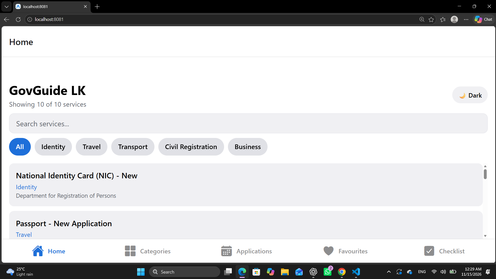
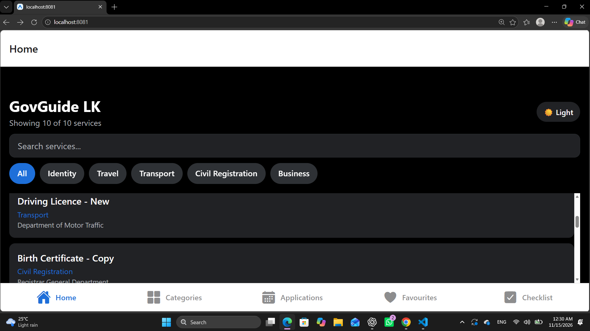
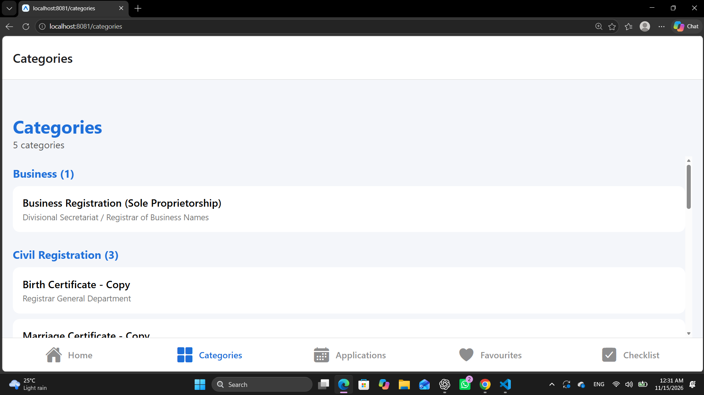
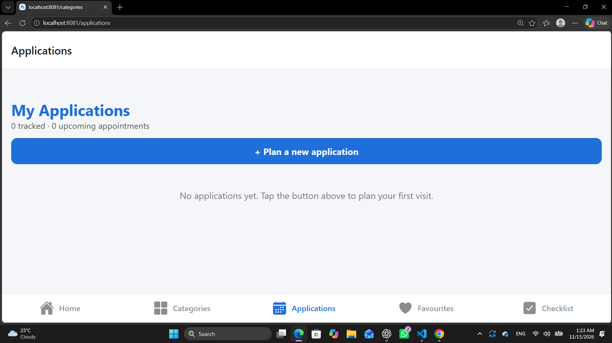
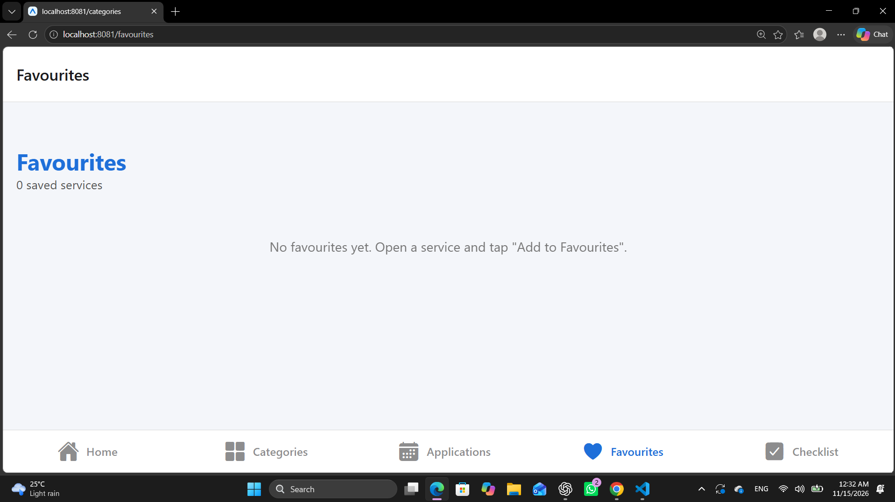
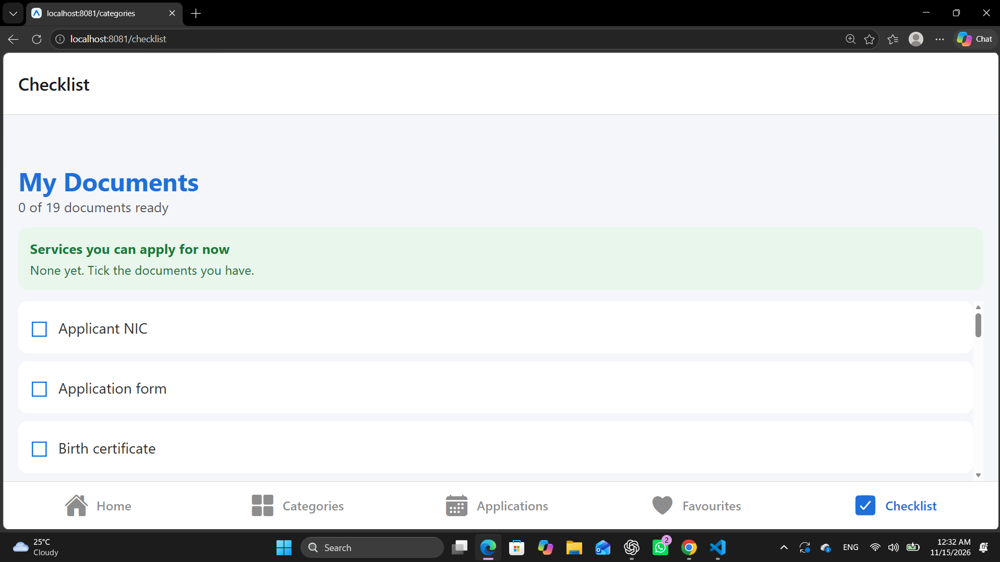

# 🇱🇰 GovGuide LK – Government Services Guide

## 📌 Project Overview

**GovGuide LK** is a mobile application designed to help Sri Lankan citizens easily discover and access information about government services.

The application provides information about government departments, available services, required documents, and application procedures in one place.

It aims to make government service information more accessible, organized, and user-friendly.

## 🎯 Objectives

- Provide easy access to Sri Lankan government service information.
- Help users find services through search and category filters.
- Display service details and required information.
- Help users organize and track their applications.
- Provide a convenient and user-friendly mobile experience.

## ✨ Main Features

### 1. Home Screen
- Displays available government services.
- Shows the total number of services.
- Provides a search option.
- Allows users to filter services by category.

### 2. Service Search
- Search services by name.
- Search by government department.
- Search by service description.

### 3. Categories
- Browse services based on categories.
- Easily identify relevant government services.

### 4. Service Details
- View detailed information about selected services.
- Access relevant department and service information.

### 5. Favourites
- Save favourite government services.
- Access saved services easily.

### 6. Application Tracker
- Keep track of applications.
- Organize application information.
- View application status.

### 7. Document Checklist
- View required documents.
- Manage document checklist items.

### 8. Light and Dark Mode
- Supports Light Mode and Dark Mode.
- Users can switch between themes.
- Theme preference is saved using local storage.

### 9. Local Data Storage
- Uses AsyncStorage to save supported user data locally.
- Helps retain saved information between app sessions.

## 🛠️ Technologies Used

| Technology | Purpose |
|---|---|
| React Native | Mobile application development |
| Expo | Development environment |
| TypeScript | Programming language |
| Expo Router | Application navigation |
| AsyncStorage | Local data storage |
| React Hooks | State and component management |
| StyleSheet | UI styling |
| DateTimePicker | Date and time selection |

## 📱 Application Screens

The application includes:

- Home
- Categories
- Service Details
- Applications
- Favourites
- Document Checklist

## 📂 Project Structure

```text
govguide-lk/
│
├── src/
│   ├── app/
│   │   ├── (tabs)/
│   │   │   ├── index.tsx
│   │   │   ├── categories.tsx
│   │   │   ├── applications.tsx
│   │   │   ├── favourites.tsx
│   │   │   └── checklist.tsx
│   │   │
│   │   └── service/
│   │
│   ├── components/
│   ├── constants/
│   │   └── theme.ts
│   │
│   ├── context/
│   │   └── ThemeContext.tsx
│   │
│   ├── data/
│   │   └── services.ts
│   │
│   └── hooks/
│       └── use-theme.ts
│
├── assets/
├── package.json
├── tsconfig.json
└── README.md
```

## ⚙️ Installation and Setup

### Prerequisites

- Node.js
- npm
- Expo development environment
- Visual Studio Code (recommended)

### Step 1: Clone the Repository

```bash
git clone https://github.com/FirthousThasnim/govguide-lk.git
```

### Step 2: Navigate to the Project

```bash
cd govguide-lk
```

### Step 3: Install Dependencies

```bash
npm install
```

### Step 4: Start the Application

```bash
npx expo start
```

### Step 5: Run the Application

Use the Expo development options to run the application on:

- Android Emulator
- iOS Simulator
- Expo Go (if compatible with the installed dependencies)
- Web Browser (if supported by the project)

## 🧪 Testing

The following features should be tested:

- Service search functionality.
- Category filtering.
- Service details navigation.
- Adding and accessing favourite services.
- Application tracking.
- Document checklist functionality.
- Light and Dark Mode switching.
- Local data persistence.

TypeScript validation:

```bash
npx tsc --noEmit
```

## 📸 Application Screenshots

### Home Screen


### Dark Mode


### Categories


### Applications


### Favourites


### Document Checklist


## 🚀 Future Improvements

- Integrate real-time government service information.
- Add user authentication.
- Provide notifications for application updates.
- Improve accessibility and multilingual support.
- Integrate official government service links.

## 👨‍💻 Developer

**Project Name:** GovGuide LK

**Developer:** Firthous Thasnim

**GitHub Repository:** FirthousThasnim/govguide-lk

## 📄 License

This project is developed for academic purposes.